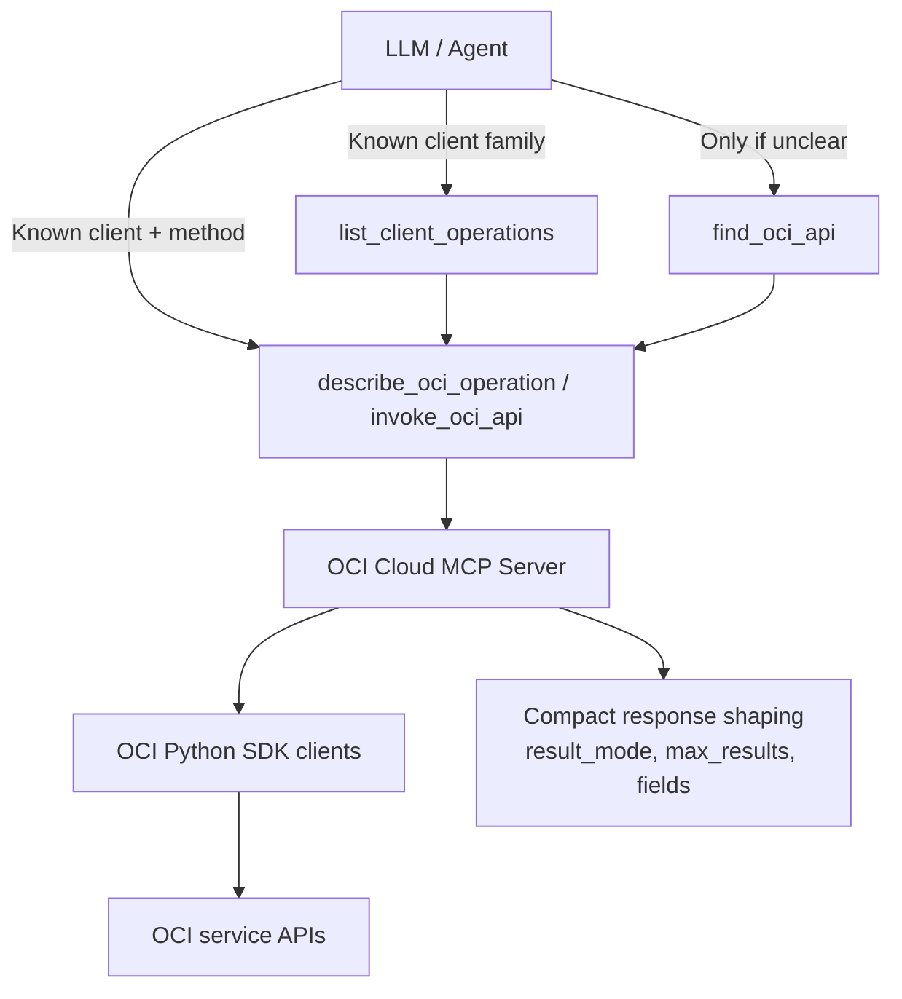

# OCI Cloud MCP Server

## Overview

This server is a thin wrapper over the official OCI Python SDK (no OCI CLI subprocess calls). Think in SDK terms: `client class -> method -> kwargs`.
Discovery is SDK-first, with thin keyword/resource-action fallback search when you genuinely cannot infer the client or method.

It exposes generic tools that let you:
- List supported OCI SDK service clients from the packaged catalog
- Search for the right OCI client operation by short keyword/resource-action search
- Inspect the exact contract of an SDK method before calling it
- Invoke supported OCI SDK service operations by fully-qualified client class and method name
- Discover available operations for a given OCI client

Recommended low-token workflow:
1. If you already know the SDK client class and method, call `describe_oci_operation` or `invoke_oci_api` directly.
2. If the service family is already obvious, call `list_client_operations` on that client class first.
3. Otherwise, call `find_oci_api` only as a thin escape-hatch fallback with a short SDK-oriented resource/action query like `"list regions"` or `"create vcn"` rather than a full sentence. Keep `limit` small (`3-5`) on the first discovery call.
4. Call `describe_oci_operation` for the chosen `client_fqn` + `operation` when you need parameter details.
5. Call `invoke_oci_api`. Its default `result_mode="auto"` keeps list, summarize, and paginated results compact. Use `result_mode="full"` only when you need the full payload, and prefer `fields` when you only need a few exact top-level values.
6. Call `list_oci_clients` only for capability discovery/debugging, or when search is ambiguous.

## Architecture



## Running the server

### Trusted SDK catalog

Client, operation and request-model identities are pinned to the packaged OCI SDK
catalog. The catalog is generated by maintainers from **OCI SDK 2.185.1**, without
changing that dependency pin. Package builds, installation and startup do not
generate or extend it. Missing, malformed or version-mismatched catalogs fail
startup; install matching server/catalog/SDK artifacts to recover.

From the repository root, maintainers generate and check the committed resource:

```sh
uv run --directory src/oci-cloud-mcp-server --locked python3 scripts/generate_sdk_catalog.py
uv run --directory src/oci-cloud-mcp-server --locked python3 scripts/generate_sdk_catalog.py --check
```

The catalog starts with `schema_version` and `sdk_version`; the latter comes
from the exact `oci==VERSION` dependency in `pyproject.toml`. Generation rejects
ranges, wildcard/conditional pins, duplicate OCI dependencies, and any disagreement
with the installed SDK, `uv.lock` or the reviewed schema-exception version before
scanning SDK declarations. A package test also compares the committed catalog's
SDK version directly with the manifest pin. Runtime checks compare the catalog
with the installed SDK; they do not require a source-tree `pyproject.toml`.

The check exits nonzero on drift and never rewrites the resource. Generation
reads explicit SDK exports, API-dispatch methods, model schemas and inheritance
declarations as syntax; it does not construct clients/models or access OCI.
`scripts/sdk_schema_exceptions.json` records exact field-type references for
which this pinned SDK exports no model. Those fields retain raw values; the
missing type names never become constructible models. New or stale exceptions
fail generation. The JSON schema records canonical identities, aliases, defining
modules, service associations, operations, model schemas and SDK artifact hashes.
Hashes document the locked input; they do not authenticate a writable installation.

Both exported names (such as `oci.core.ComputeClient`) and defining-module names
(`oci.core.compute_client.ComputeClient`) resolve to the same supported client.
The same rule applies to exported and defining-module model FQNs, including both
`__model_fqn` and `__class_fqn` hints. Short `__model`/`__class` hints stay scoped
to the selected service; explicit model FQNs may select another supported service.
Nested fields and polymorphic subtypes use the selected model's service and
approved inheritance relationships. Conflicting or unknown model hints fail
before credentials or request-model/client construction. Public service API
operations remain supported; infrastructure, private/vendor classes, transfer
helpers and composite-operation wrappers are excluded. Error hints do not
retry resolution of rejected names. Catalog membership does not authorize an
operation or change write-policy defaults; OCI caller permissions still apply.

Run under a nonroot identity that cannot modify the application, SDK, environment
or other Python import locations. Provision those files under a separate build
identity and mount them read-only or enforce equivalent filesystem permissions.
Nonroot execution alone is insufficient: the example Containerfile copies `/app`
with runtime-user ownership. Verify effective image ownership, mounts and import
locations in the deployment separately; this package change does not establish
that a deployed image has those protections.

### Updating the pinned SDK and catalog

Use a controlled maintainer environment and the repository's pinned tools
(`proto install`); run these commands from the repository root. Builds and
startup must continue to consume the committed resource without regeneration.

1. Change the exact `oci==VERSION` pin in `pyproject.toml`, then run
   `uv lock --directory src/oci-cloud-mcp-server` and
   `uv sync --directory src/oci-cloud-mcp-server --locked --all-extras --dev`.
   Review the dependency diff; preserve unrelated pins. The generator reads this
   manifest pin directly, so there is no separate generator version constant.
2. Review the selected SDK's exported clients, operations, aliases, model schemas
   and inheritance changes. Reconcile `scripts/sdk_schema_exceptions.json` with
   that SDK and update its `sdk_version`: remove resolved references and record
   newly missing model/field/type triples only after checking the SDK source.
   Changing the exception version alone does not establish compatibility;
   unexplained or stale references fail generation.
3. Run the generation and `--check` commands in [Trusted SDK catalog](#trusted-sdk-catalog).
   Review the generated diff for omissions and changed identities, operations,
   schemas and subtype relationships. Do not hand-edit the catalog or restore
   request-driven imports to bypass a rejected entry. Update SDK-specific test
   expectations only after independently verifying the new inventory.
4. Run `moon run oci-cloud-mcp-server:lock-check`,
   `moon run oci-cloud-mcp-server:test`, `moon run root:lint` and
   `moon run oci-cloud-mcp-server:build`. The package test gate requires at least
   90% coverage; inspect failures rather than weakening catalog restrictions.
5. Install the wheel and sdist separately into fresh environments outside the
   checkout; also rebuild the sdist into a wheel and test that installation.
   Use non-editable installs with matching dependencies. From a clean directory
   outside the checkout, run this with each environment's Python:

   ```sh
   <fresh-env>/bin/python3 <checkout>/src/oci-cloud-mcp-server/scripts/check_installed_catalog.py \
     --forbid-root <checkout> --catalog-sha256 <committed-catalog-sha256>
   ```

   Also verify that disposable installed copies reject missing/malformed catalogs
   and version mismatches before authentication or serving. Source-tree imports
   do not establish distribution correctness.
6. Include the manifest/lock, regenerated resource, reviewed exception metadata,
   relevant tests and operator-visible changelog updates in the same SDK change.
   Catalog membership remains separate from authorization policy.

### STDIO transport mode

```sh
uvx oracle.oci-cloud-mcp-server
```

### HTTP streaming transport mode

```sh
ORACLE_MCP_HOST=<bind_host> \
ORACLE_MCP_PORT=<port> \
ORACLE_MCP_BASE_URL=<public_base_url> \
OCI_REGION=<region> \
IDCS_DOMAIN=<idcs_domain> \
IDCS_CLIENT_ID=<client_id> \
IDCS_CLIENT_SECRET=<client_secret> \
IDCS_AUDIENCE=<audience> \
uvx oracle.oci-cloud-mcp-server
```

Register `${ORACLE_MCP_BASE_URL}/auth/callback` in the OCI IAM confidential application. If `IDCS_REQUIRED_SCOPES` is unset, the default is `openid profile email oci_mcp.cloud.invoke`. `stdio` uses the configured OCI CLI profile; HTTP uses the authenticated OCI IAM user.

## Tools

| Tool Name | Description |
| --- | --- |
| list_oci_clients | List service clients supported by the packaged SDK catalog; best for capability discovery/debugging. |
| find_oci_api | Thin fallback keyword/resource-action search across OCI SDK client methods and return compact matches with `client_fqn` + `operation`. |
| describe_oci_operation | Describe a specific OCI SDK method, including required params, optional params, pagination behavior, aliases, and request model hints. |
| invoke_oci_api | Invoke an OCI Python SDK client method via `client_fqn` + `operation`. Example: client_fqn="oci.core.ComputeClient", operation="list_instances", params={"compartment_id": "ocid1.compartment.oc1..."} |
| list_client_operations | List public callable operations for a given OCI client class (by fully-qualified name), with optional filtering and compact mode. |

### list_oci_clients

Returns a stable list of OCI SDK service clients supported by the packaged catalog.
Prefer `find_oci_api` for task-oriented requests; use this tool when you need to inspect capabilities or debug SDK availability.

Example usage:
```json
{}
```

Response (shape):
```json
{
  "count": 2,
  "clients": [
    { "client_fqn": "oci.core.ComputeClient", "module": "oci.core", "class": "ComputeClient" },
    { "client_fqn": "oci.identity.IdentityClient", "module": "oci.identity", "class": "IdentityClient" }
  ]
}
```

### find_oci_api

- query: Short SDK-oriented resource/action query such as `list regions`, `launch instance`, `instance list`, or `vcn create`
- client_fqn: Optional client filter when you already know the client
- limit: Maximum matches to return; default is `5` and you should usually keep it in the `3-5` range on the first discovery call
- include_params: Include compact method signatures in the response

This is a thin fallback keyword search over OCI SDK client/method metadata, not free-form natural language understanding.
Reduce requests to short search terms rather than full user sentences, and prefer `list_client_operations` whenever you can already narrow the problem.
Treat this as an escape hatch, not the normal first step.

Example usage:
```json
{
  "query": "list instances",
  "limit": 5
}
```

### describe_oci_operation

- client_fqn: Fully-qualified client class, e.g. `oci.core.VirtualNetworkClient`
- operation: Operation name, e.g. `create_vcn`
- max_model_fields: Maximum number of request-model fields to return per model hint

This is the fastest way to learn:
- which params are required
- whether pagination applies
- whether `vcn_details` aliases to `create_vcn_details`
- which top-level fields exist on a request model such as `CreateVcnDetails`

### invoke_oci_api

- client_fqn: Fully-qualified client class name, e.g. `oci.core.ComputeClient`
- operation: Client method/operation, e.g. `list_instances`, `get_instance`, `launch_instance`, etc.
- params: JSON object of keyword arguments as expected by the SDK method (snake_case). These are the same kwargs you would pass in the OCI Python SDK. The server automatically paginates supported collection responses when the SDK operation declares continuation arguments; `list_` and `summarize_` names alone do not enable pagination.
- fields: Optional top-level response fields to project from an object response or each list item after serialization, e.g. `["id", "display_name", "lifecycle_state"]`
- max_results: Optional total result cap for paginated operations, or top-level list trim for non-paginated responses.
- result_mode: `auto` (default), `full`, or `summary`. `auto` keeps list, summarize, and paginated results compact while leaving other operations full by default.

Collection handling preserves existing list, `items`, Logging Search `results`, DNS, and Object Storage output shapes. Unset SDK record arrays are treated as empty pages, not scalar responses; continuation and page metadata are still processed, including Object Storage pages containing only prefixes. Other SDK envelopes with a single declared record array (including Identity Domains `resources`) retain their native object shape with aggregated records. Original per-page non-record fields are retained in `result_meta.page_metadata`, including search summaries and SCIM paging metadata. Aggregated SCIM envelopes retain the first `start_index` and service `total_results`, with `items_per_page` reflecting the number of returned resources.

Identity Domains follows `page` tokens when available, or, when the SDK method accepts `start_index`, SCIM continuation derived from the response's resource count and `total_results`. Explicit `start_index`/`count` parameters select SCIM mode. Search operations such as `search_users` carry offsets inside their request model; without a page token, the fetched page is preserved and `has_more_results` reports remaining resources. Continue those searches manually by updating the request model offset. Object Storage continues via `start`, not `page`. `result_meta.has_more_results` is available in full and summary modes; when a cap stops at a page boundary, continuation is reported as `page`, `start`, or `start_index` in `result_meta`. If the cap cuts a page, no lossless continuation is advertised. Preserve the original query parameters when continuing.

Every successful result includes boolean `result_meta.has_more_results` and `result_meta.truncated`, independent of result mode or payload shape. They indicate underlying result incompleteness, including discarded records within a fetched page; reaching `max_results` exactly on a final page does not imply truncation. Summary `data.sample_truncated` describes only the local structural sample and is independent of result completeness. An incomplete result without a supported continuation does not promise lossless resumption; rerun with a larger cap or narrower query instead. Native continuation fields and `result_meta.page_metadata` describe backend pages, not an intra-page resume cursor.

Scalar and ambiguous multi-array aggregates are returned as native payloads rather than flattened or iterated. If such a response has an SDK next-page token, it is returned as a single page with `pagination_used=false`, `has_more_results=true`, and `result_meta.next_page`; callers can invoke the same operation with `params.page` to continue. No service-specific merge of aggregate metrics is inferred.

This is a thin wrapper over the corresponding OCI Python SDK method call.
Equivalent Python:
`oci.core.ComputeClient.list_instances(compartment_id="ocid1.compartment...")`
Equivalent MCP payload:
`client_fqn="oci.core.ComputeClient", operation="list_instances", params={"compartment_id": "ocid1.compartment..."}`

Example usage:
```json
{
  "client_fqn": "oci.core.ComputeClient",
  "operation": "list_instances",
  "params": {
    "compartment_id": "ocid1.compartment.oc1..exampleuniqueID"
  },
  "fields": ["id", "display_name", "lifecycle_state"],
  "max_results": 10
}
```

Response (shape):
```json
{
  "client": "oci.core.ComputeClient",
  "operation": "list_instances",
  "params": { "...": "..." },
  "opc_request_id": "abcd-efgh-....",
  "data": { /* full payload or compact summary */ },
  "result_meta": {
    "result_mode": "summary",
    "pagination_used": true,
    "max_results": 10
  }
}
```

Notes:
- When `max_results` is set and pagination applies, the server uses the OCI SDK's bounded paginator instead of fetching the full result set first.
- When `result_mode="auto"`, list, summarize, and paginated operations default to compact summary output while other operations stay full by default.
- When `result_mode="summary"`, the server returns a compact shape that keeps counts, representative samples, and key names while avoiding large payloads.
- When `fields` is set, the server applies a top-level field projection after serialization. This changes only the returned payload shape, not the SDK call itself; unmatched field selections include `available_fields` metadata, and fully unmatched selections surface as errors instead of silently returning empty objects.
- The server now normalizes common type mistakes when SDK metadata is clear, such as `"3"` to `3`, `"true"` to `true`, and simple request-model field coercions based on OCI `swagger_types`.
- On likely parameter-shape invocation errors, the server includes repair hints such as similar operation names, method signatures, expected params, accepted kwargs, and aliases when it can infer them.
- Exposed tools only accept OCI SDK client classes under the `oci.` namespace whose class name ends in `Client`.

### list_client_operations

- client_fqn: Fully-qualified client class name, e.g. `oci.identity.IdentityClient`
- query: Optional filter to avoid returning the full operation list
- limit: Optional maximum number of operations to return
- include_params: Set to `false` for a smaller response
Returns a list of operations with a short summary extracted from docstrings when available.

Example compact usage:
```json
{
  "client_fqn": "oci.core.ComputeClient",
  "query": "instance",
  "limit": 10,
  "include_params": false
}
```

## Passing complex model parameters

Many OCI SDK operations expect complex model instances (e.g., CreateVcnDetails) rather than raw dictionaries.
This server now automatically constructs SDK model objects from JSON parameters using heuristics:

- If a parameter name ends with "_details", "_config", "_configuration", or "_source_details", the value will be
  coerced into the appropriate model class from the client's models module.
  - Example: For VirtualNetworkClient.create_vcn, either of these will work:
    {
      "client_fqn": "oci.core.VirtualNetworkClient",
      "operation": "create_vcn",
      "params": {
        "create_vcn_details": {
          "cidr_block": "10.0.0.0/16",
          "compartment_id": "ocid1.compartment.oc1..exampleuniqueID",
          "display_name": "my-vcn"
        }
      }
    }
    {
      "client_fqn": "oci.core.VirtualNetworkClient",
      "operation": "create_vcn",
      "params": {
        "vcn_details": {
          "cidr_block": "10.0.0.0/16",
          "compartment_id": "ocid1.compartment.oc1..exampleuniqueID",
          "display_name": "my-vcn"
        }
      }
    }
  In both cases, the server will construct an instance of oci.core.models.CreateVcnDetails.

- For "create_*" and "update_*" operations, if the parameter is named like "vcn_details" (missing the verb),
  the server will also try CreateVcnDetails/UpdateVcnDetails automatically.

- Nested dictionaries and lists inside such parameters are recursively coerced. For lists that do not obviously
  map to a model type, you can provide explicit hints.

Explicit model hints (optional):
- __model: Simple class name in the client's models module (e.g., "CreateVcnDetails")
- __model_fqn: Fully-qualified class name (e.g., "oci.core.models.CreateVcnDetails")

Example with explicit hint:
{
  "client_fqn": "oci.core.VirtualNetworkClient",
  "operation": "create_vcn",
  "params": {
    "create_vcn_details": {
      "__model": "CreateVcnDetails",
      "cidr_block": "10.0.0.0/16",
      "compartment_id": "ocid1.compartment.oc1..exampleuniqueID",
      "display_name": "my-vcn"
    }
  }
}

Note:
- Parameter names must match the SDK's expected kwargs. For example, the SDK expects "create_vcn_details" for create_vcn.
  The heuristic also accepts "vcn_details" and will resolve it to the correct model class, but the keyword name still needs to be correct for other methods without such ambiguity.

## Authentication and configuration

For `stdio`, the server uses `oracle-mcp-common` to resolve outbound OCI SDK
authentication. Set `OCI_MCP_AUTH_TYPE` to one of:

- `auto` (default): use a security token only when the selected profile directly declares `security_token_file`; otherwise use that profile's API key
- `api_key` or `security_token`: explicitly select an OCI CLI-compatible profile mode
- `identity_domain_upst`: exchange a file-backed Identity Domains JWT for an OCI UPST
- `instance_principal`, `resource_principal`, `resource_principal_v212`, `instance_principal_delegation`, `resource_principal_delegation`, or `oke_workload_identity`

Profile-backed modes load the default `~/.oci/config`, or the file and profile
selected by `OCI_CONFIG_FILE` and `OCI_CONFIG_PROFILE`. `OCI_REGION` overrides
the target SDK client region without changing the selected identity. A directly
selected session-token profile that is unreadable or invalid fails with an
actionable error; it does not silently fall back to API-key authentication.

Principal, delegation, OKE, and Identity Domains modes use the canonical
`OCI_MCP_*` variables documented by `oracle-mcp-common`. Every mode receives the
server's derived additional user-agent suffix for MCP telemetry.

| Authentication mode | Required configuration beyond `OCI_MCP_AUTH_TYPE` |
| --- | --- |
| `instance_principal`, `resource_principal` | None; the OCI SDK discovers the runtime principal |
| `instance_principal_delegation`, `resource_principal_delegation` | `OCI_MCP_DELEGATION_TOKEN_FILE` |
| `oke_workload_identity` | None by default; `OCI_MCP_OKE_SERVICE_ACCOUNT_TOKEN_PATH` optionally overrides the mounted token |
| `identity_domain_upst` | `OCI_MCP_IDENTITY_DOMAIN_URL`, `OCI_MCP_UPST_JWT_FILE`, `OCI_MCP_IDENTITY_DOMAIN_CLIENT_ID`, `OCI_MCP_IDENTITY_DOMAIN_CLIENT_SECRET_FILE`, and `OCI_REGION` |
| `resource_principal_v212` | `OCI_REGION`, `OCI_MCP_RP_TENANCY_ID`, `OCI_MCP_RP_RESOURCE_ID`, `OCI_MCP_RP_PRIVATE_KEY_PATH`, `OCI_MCP_RP_RCI`, and `OCI_MCP_RP_T0` |

`resource_principal_v212` enables the Database-service RPv2.1.2
resource-principal exchange. The RPT and RPST endpoints default to the
region's OCI realm; override them only when required with
`OCI_MCP_RP_RPT_ENDPOINT` and `OCI_MCP_RP_RPST_ENDPOINT`. Treat
`OCI_MCP_RP_RCI` as sensitive HMAC-key material and do not log or commit it.

HTTP transport authentication remains separate from `stdio`. At startup, the
server uses `oracle-mcp-common` to configure the OCI IAM/IDCS provider from
`IDCS_*`, `ORACLE_MCP_BASE_URL`, and the required scopes. For each authenticated
HTTP request, it passes the FastMCP access token to the shared HTTP policy to
create a caller-specific token-exchange signer using `OCI_REGION`. Signers and
OCI SDK clients are not reused across HTTP callers.

Ensure your configured principal has the necessary permissions (least privilege recommended).

## Security and privacy

All actions are performed with the permissions of the selected OCI principal or authenticated HTTP user. Follow best practices:
- Use least-privilege IAM policies
- Manage credentials securely
- Avoid logging sensitive data
- Be mindful of network egress and data residency

## Third-Party APIs

Developers choosing to distribute a binary implementation of this project are responsible for obtaining and providing all required licenses and copyright notices for the third-party code used in order to ensure compliance with their respective open source licenses.

## Disclaimer

Users are responsible for their local environment and credential safety. Different language model selections may yield different results and performance.

## License

Copyright (c) 2026 Oracle and/or its affiliates.

Released under the Universal Permissive License v1.0 as shown at  
<https://oss.oracle.com/licenses/upl/>.
